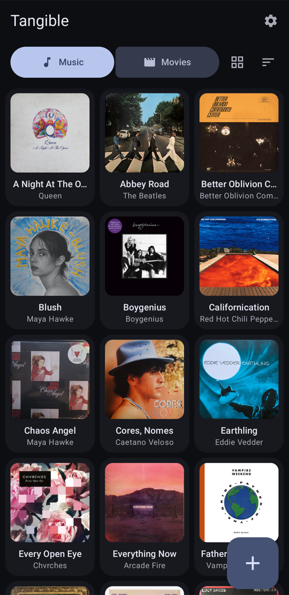
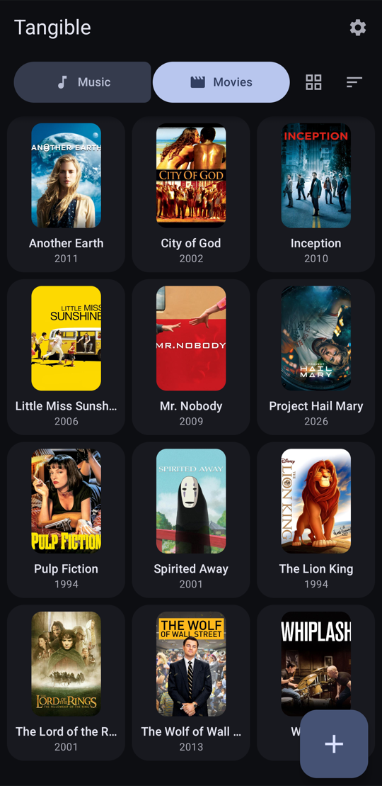
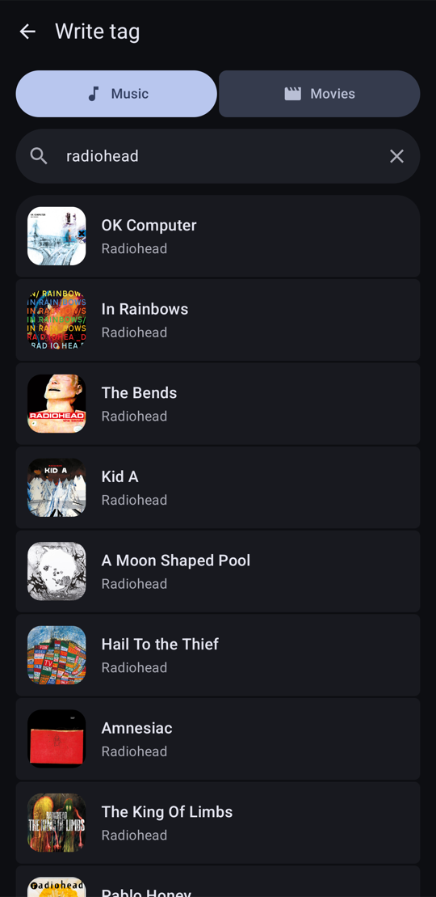
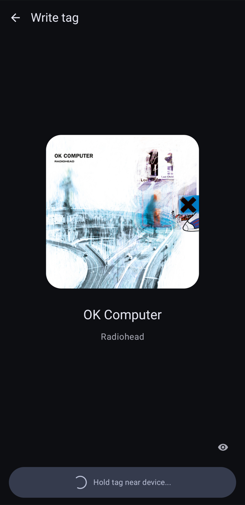
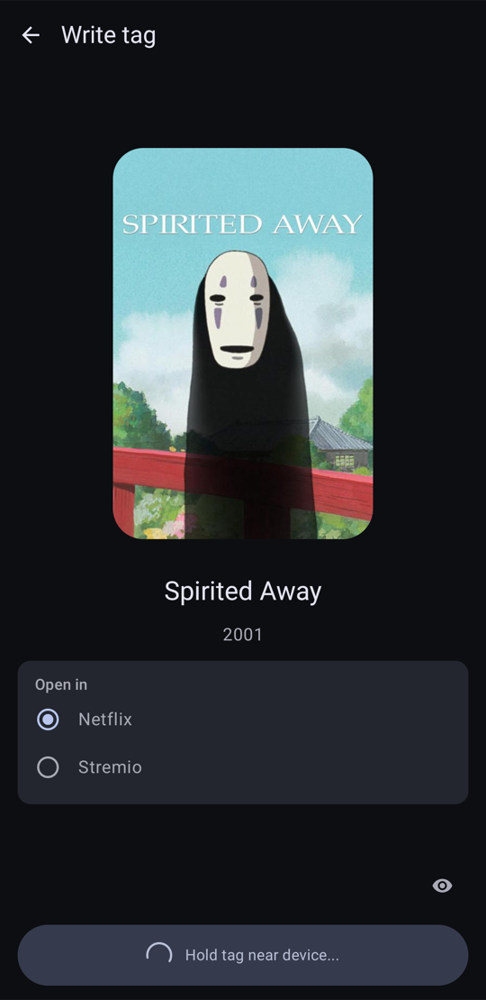
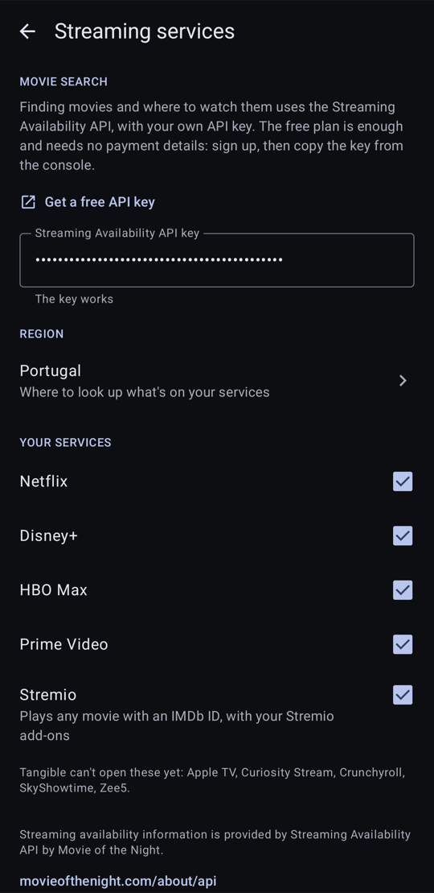

# Tangible

Physical media → NFC → digital media.

Stick an NFC tag on a vinyl, CD or DVD, write it with Tangible, and scanning it later plays that
album or movie on your speakers or TV. It's an Android app (Kotlin, Jetpack Compose) that does
everything through your own [Home Assistant](https://www.home-assistant.io). It isn't on the Play
Store: you build it yourself.

<p>
  
  
  
</p>
<p>
  
  
  
</p>

## What you need

- An Android phone with NFC (Android 11 or newer) and some NFC tags. NTAG213 or bigger works.
- Home Assistant on your network, reachable from the phone.
- **For music:** [Music Assistant](https://music-assistant.io) with its Home Assistant integration,
  and your music provider (Spotify, or your own library) added in Music Assistant.
- **For movies:**
  - A Google TV or Android TV, set up in Home Assistant with the
    [Android TV Remote](https://www.home-assistant.io/integrations/androidtv_remote/) integration.
  - A free [Streaming Availability API](https://developers.movieofthenight.com/) key (see below).
  - Subscriptions to the streaming services you'll play from, with their apps on the TV.

## How it works

### Music

- **Writing a tag:** search for an album; the search goes through Music Assistant, so it covers
  your providers and your library. Tangible writes the album to the tag:
  `tangible://play?spotify_album=<id>` for a Spotify album, `tangible://play?album=<Music Assistant
  URI>` for anything else.
- **Playing:** scanning the tag, or tapping it in the collection, asks Music Assistant to play the
  album on your default player (Home Assistant's `music_assistant.play_media` action). To play on
  several speakers, create a player group in Music Assistant and pick it as the default player.
- **Now Playing:** opens after you start an album, with the cover, progress, play/pause,
  previous/next, seek, volume, and a player switcher that moves the queue to another player. A
  mini player sits above the collection while something is loaded.
- **Media controls:** while an album plays, Android's media controls (quick settings and the lock
  screen) control the speaker, and the phone's volume keys set the speaker's volume.
- **Default volume** (optional): the player is set to this volume right before an album starts.

### Movies

- **Writing a tag:** search for a movie. Tangible looks up where it's included in a subscription in
  your region, among the services you've ticked in Settings → Streaming services, and you pick which one the tag opens.
  The tag holds that one service: `tangible://movie?tmdb=<id>&<service>=<content id>`.
- **Playing:** scanning the tag, or tapping it in the collection, asks Home Assistant to open the
  movie's link on your TV (`media_player.play_media`), so the streaming app comes to the front on
  that movie. The Google TV app's remote opens on the phone at the same time, if it's installed.
- **Services Tangible can open:** Netflix, Disney+, HBO Max and Prime Video, where they're
  available in your region, and [Stremio](https://www.stremio.com) for any movie with an IMDb ID.
  Other services the API knows (Apple TV, Hulu and so on) are listed in Settings but can't be
  opened yet, because each needs a link format that's been tested on a TV.
- **Posters:** Tangible keeps a copy of each movie tag's poster on the phone, because the API's
  poster links expire after some months. A missing copy is fetched again quietly.

## Setup

1. **Home Assistant:** set up Music Assistant and/or the Android TV Remote integration (see
   [What you need](#what-you-need)). Then create a long-lived access token: your profile →
   Security → Long-lived access tokens.
2. **Streaming Availability API key** (movies only):
   1. Sign up on the [Movie of the Night developers platform](https://developers.movieofthenight.com/).
      The free plan is enough and doesn't ask for payment details (it allowed 1,000 requests a
      month when this was written).
   2. Copy your API key from the console.
   3. Each movie search is one request. Your key is yours alone: don't share it, and don't use a
      key from RapidAPI, which works differently.
3. **In Tangible**, open Settings:
   - **Home Assistant → Server:** your Home Assistant address, e.g.
     `http://homeassistant.local:8123`, and the access token.
   - **Music → Music player:** pick a player (or a player group), and optionally a default volume.
   - **Movies → Streaming services:**
     - Paste the API key. Tangible checks it and loads the regions the API covers.
     - **Region** starts as your phone's region; change it if you subscribe somewhere else.
     - Tick the services you have.
   - **Movies → Movie player:** pick your TV.
4. **Android 15+:** if Tangible shows "NFC tags can't open Tangible", tap **Allow**. Android lets
   you block apps from opening on an NFC scan, and a blocked scan only brings the app to the front
   without playing.

Tags and the collection can be exported and imported in Settings → Backup.

## Privacy and security

- The Home Assistant token and the API key are encrypted with a key in the Android Keystore, and
  left out of Android's backups.
- Plain `http://` is allowed so local addresses like `http://homeassistant.local:8123` work. Use
  `https://` if your Home Assistant is reachable from outside your network.
- Tangible talks only to your Home Assistant, the Streaming Availability API, and the image hosts
  of the covers and posters it shows.

## Building and installing

Needs JDK 17+ (Android Studio's bundled JBR works) and the Android SDK.

```bash
./gradlew :app:testDebugUnitTest
```

```bash
./gradlew :app:assembleDebug
```

```bash
adb install -r app/build/outputs/apk/debug/app-debug.apk
```

## Good to know

- The TV links are tested on a Google TV Streamer. A few rely on details that may change:
  Netflix only opens the title with `?source=30` on the link, and the phone's TV remote is opened
  with an undocumented Google TV app intent.
- Android TV Remote doesn't report what's playing, so there's no Now Playing for movies.
- The app ID is still `com.example.tangible`: tags written by older versions name it, and Android
  opens Google Play for them when that app ID isn't installed.

## Credits

Streaming availability information is provided by
[Streaming Availability API by Movie of the Night](https://www.movieofthenight.com/about/api).
Its images can only be used while you have a subscription to the API (the free plan counts).

## License

[MIT](LICENSE)
